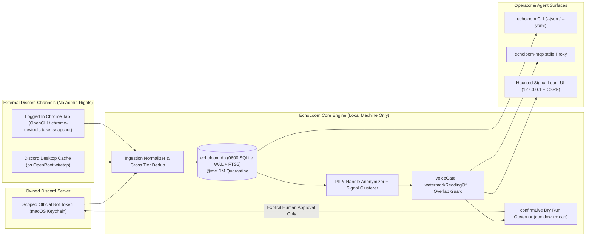

# Kiro Spec: EchoLoom Architecture & Data Flow

1. **Architecture Pattern**: Local first dual runtime stitching pure Go (`discrawl` SQLite WAL + Keychain/ACL + `bot_api` + `wiretap`) with TypeScript/Bun (`ListeningKit` hot reloading `stdio` MCP + `voiceGate` + `confirmLive` + Haunted Signal Loom UI) and `OpenCLI` / `chrome-devtools` snapshot ingestion.

## 1. End to End Component Topology

## 2. Kiro Crew 4 Agent Responsibilities

| Kiro Crew Agent | Owned Modules | Strict Boundaries |
| :--- | :--- | :--- |
| **1. `signal-collector`** | `internal/discord/`, `internal/syncer/`, `internal/wiretap/`, `internal/snapshot/` | Read only collection; cannot touch outbound Discord write credentials or post endpoints. |
| **2. `topic-synthesizer`** | `internal/signals/`, `internal/cli/` | Runs anonymizer before exposing any external `desktop_wiretap` or `browser_snapshot` cluster upstream. |
| **3. `voice-composer`** | `src/voice/` | Reads only owner authored posts in owned servers plus anonymized clusters; cannot call Discord write transports. |
| **4. `safety-governor`** | `internal/media/allowlist.go`, `internal/store/query.go`, `src/governor/` | Verifies SSRF allowlist, `@me` isolation, `voiceGate` pass token, claim lock, and `confirmLive: true` gate before release. |

## 3. SQLite Schema & Storage Contracts

1. **Core Tables**: `events`, `channels`, `messages`, `message_fts`, `message_attachments`, `members`, `sync_state`, `signal_clusters`, `drafts`, `claim_locks`, `outbound_ledger`, and `failure_ledger`.
2. **Quarantine & Scopes**: Every channel carries `collection_scope` (`allowed`, `excluded`, `private_dm`, `unknown`) and every message carries `source_tier` (`bot_api`, `desktop_wiretap`, `browser_snapshot`).
3. **DSN Escaping Fix**: `openReadOnlyDB` builds file URIs with `url.PathEscape` and enforces single statement AST inspection (`SELECT`, `WITH`, `EXPLAIN QUERY PLAN`), closing the `discrawl` `query.go` bypass surface.
